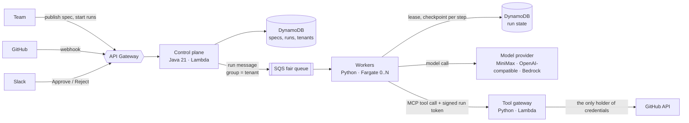

# Agent Builder & Runtime Platform

A multi-tenant platform for AI agents. A team describes an agent in a short YAML spec (model,
instructions, tools, budget, which calls need a human's approval) and publishes it; the platform
versions the spec, starts a run whenever its trigger fires, and executes it reliably: crash-safe,
within budget, with risky tool calls held for approval in Slack, and with per-tenant limits so one
noisy tenant cannot starve the others. It runs on AWS and costs about $1 a month when idle.

The demo agent triages GitHub issues: it labels a new issue, finds duplicates, and closes a
confirmed duplicate only after a person clicks Approve in Slack.

## Results

Measured on the AWS deployment ([`loadtest/report.md`](loadtest/report.md), [`evals/`](evals/)):

| What | Result |
| --- | --- |
| Scale | 1,000 runs started within 50 s all succeeded; up to 918 executing at once on 20 workers |
| Crash safety | 12 workers stopped during a 1,000-run test (6 killed mid-run): 88 runs taken over by other workers, **0 lost, 0 duplicate side effects** |
| Noisy neighbor | One tenant bursts 1,000 runs (cap 100 at once) while another sends 1 a second: the burst tenant stays at its cap, the quiet tenant's runs are picked up within **0.1 s (p95)** |
| Provider rate limits | With 20% of model calls answering 429: **0 of 1,197 runs failed**; 579 runs were set aside and resumed from their checkpoints |
| Spend caps | A tenant over its daily spend cap gets new runs refused (6 of 6) |
| Agent quality | Eval suite on the real model: issue-triage passes 29 of 30 tasks, a second spec 8 of 8 |
| Idle cost | No hourly resources: Lambdas, Fargate scaled to 0, on-demand DynamoDB; about $1 a month (a KMS key) |

About 1,350 tests across the services (unit, port contract suites run against every adapter,
integration with DynamoDB Local and ElasticMQ in Testcontainers).

## How it works



- **Control plane** (Java 21, Spring Boot on Lambda with SnapStart): agents and immutable spec
  versions, runs and their status rules, approvals, tenants and their limits. The only service
  that touches its table; workers use its internal API, signed with SigV4.
- **Workers** (Python on Fargate, scaled from 0 on queue depth): the agent loop. Every model reply
  is checked before anything acts on it (only the spec's tools, arguments validated against the
  tool's schema, approval-gated calls paused). Each step is checkpointed under a fenced lease, so
  a run whose worker dies resumes on another worker without repeating a tool call.
- **Tool gateway** (Python, MCP, on Lambda): the only path to outside APIs and the only holder of
  credentials. Connectors are generated from the provider's OpenAPI description and an
  allowlist of operations (GitHub today); each call carries a signed run token naming the run,
  its tenant, the tools it may call and the identity it acts as (`acts_as`).
- **Contracts** (`contracts/`): JSON Schema and OpenAPI shapes every service is tested against.

A spec, trimmed ([full file](specs/issue-triage.yaml)):

```yaml
name: issue-triage
model: minimax/MiniMax-M3
trigger: github.issue.opened
acts_as: team-bot
tools: [github.search_issues, github.add_label, github.close_issue]
require_approval: [github.close_issue]
budget: { max_steps: 20, max_usd: 0.05, max_seconds: 180 }
instructions: |
  You triage a newly opened GitHub issue. ...
```

## Design decisions

Each choice has a decision record in [`docs/adr/`](docs/adr/README.md) (28 in all). The main ones:

- **The worker owns the agent loop** instead of an agent framework, so every model reply passes
  the platform's checks before anything acts on it ([0009](docs/adr/0009-worker-owns-agent-loop.md)).
- **Per-step checkpoints under a fenced lease, idempotency keys per tool call**; a call whose
  outcome a crash left unknown is repeated only if the tool is read-only or idempotent
  ([0011](docs/adr/0011-run-state-per-step-fenced.md), [0013](docs/adr/0013-unknown-tool-outcome.md)).
- **A separate tool gateway holds every credential**; workers hold none
  ([0006](docs/adr/0006-separate-tool-gateway.md), [0003](docs/adr/0003-run-identity-and-run-token.md)).
- **Ports and adapters**: the worker's core imports no vendor SDK, and every adapter passes its
  port's contract suite ([0004](docs/adr/0004-ports-and-adapters.md)); model providers are config
  ([0010](docs/adr/0010-provider-neutral-model-layer.md)).
- **Scale to zero**: Lambdas behind one HTTP API, Fargate workers at 0 when idle
  ([0007](docs/adr/0007-serverless-scale-to-zero-deployment.md)).
- **Tenant limits at start**: a slot per running run, taken in the same DynamoDB transaction as
  the status change; at the cap the run is re-queued with a delay; an SQS fair queue keyed by
  tenant ([0026](docs/adr/0026-tenant-limits-checked-at-start.md)). A model still rate limited
  after retries sets the run aside instead of failing it
  ([0027](docs/adr/0027-set-runs-aside-on-model-rate-limits.md)).

## Run it locally

Needs Docker (with Compose) and `make`; no AWS account or API key.

```sh
make up      # build and start everything (DynamoDB Local, ElasticMQ, control plane, gateway, worker)
make demo    # publish the example spec with a stub model, start a run, wait until it SUCCEEDED
make chaos   # kill the worker mid-run: the run resumes and adds its label exactly once
make down    # stop everything and delete local data
```

With a model key: `make eval` scores the specs on the real model against a simulated GitHub
([`evals/AGENTS.md`](evals/AGENTS.md)). Real GitHub tools, Slack approvals and the AWS deployment
are described in [`specs/README.md`](specs/README.md) and [`infra/AGENTS.md`](infra/AGENTS.md).
Commands for every component: [`AGENTS.md`](AGENTS.md) → Commands.

## Repository

```
contracts/       shared schemas: agent spec, run message, run token, internal API, MCP tool call
control-plane/   Java 21, Spring Boot: specs, runs, approvals, tenants and limits
worker/          Python 3.12: the agent loop, checkpoints, model adapters
tool-gateway/    Python, FastAPI + MCP: connectors, run-token checks, credentials
specs/           example agent specs (issue-triage, needs-info)
evals/           eval tasks, LLM judge, baselines, `make eval`
loadtest/        load, chaos and tenant-limits drivers and their report
infra/           Terraform for AWS (scale to zero)
local-stack/     local AWS stand-ins and the demo scripts
docs/            product, architecture, roadmap, decision records
```

## Documentation

| Doc | Read it for |
| --- | --- |
| [Product](docs/product.md) | What the platform does, its concepts and vocabulary |
| [Architecture](docs/architecture.md) | Components, data flow, security, configuration, deployment, testing |
| [Decision records](docs/adr/README.md) | Why each design choice was made |
| [Load and limits report](loadtest/report.md) | Scale, chaos and tenant-limit tests on AWS, with numbers |
| [Roadmap](docs/roadmap.md) | Milestones M0-M8 and what was built in each; future work |

## Status

Complete: milestones M0 (local skeleton) to M8 (production limits) are done and deployed on AWS.
Ideas for future work (users and roles, GitHub App installations per tenant, CI) are listed in
the [roadmap](docs/roadmap.md#future-work).
