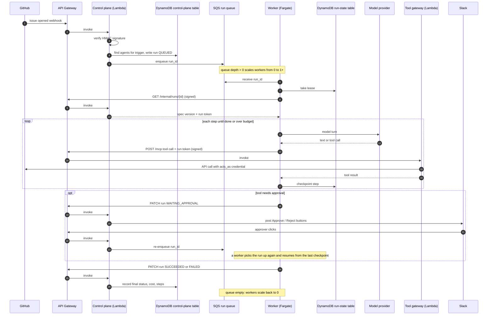

# Architecture

How the platform is built. For what it does and its vocabulary, see [product.md](product.md). For
why a choice was made, see the [decision records](adr/README.md).

## Overview


Every component emits OpenTelemetry spans to CloudWatch and X-Ray, one trace per run.

### Run lifecycle

One run of the issue-triage agent, from webhook to finish:



Nothing is billed per hour while idle: the control plane and gateway are Lambda functions, workers
scale to 0, both data stores are DynamoDB on-demand, and model providers bill per token
([ADR 0007](adr/0007-serverless-scale-to-zero-deployment.md)).

## Components

| Component     | Runs on                 | Owns                                                          | Talks to                                                 |
| ------------- | ----------------------- | ------------------------------------------------------------- | -------------------------------------------------------- |
| Control plane | Lambda (SnapStart)      | Tenants, specs and versions, runs, approvals, Slack bot       | Control-plane DynamoDB table, SQS (send), Slack          |
| Worker        | ECS Fargate, 0..N tasks | Executing one run: agent loop, budget, checkpoints            | SQS (receive), run-state DynamoDB table, model providers, control plane, gateway |
| Tool gateway  | Lambda                  | OAuth tokens, connector definitions, outside API calls        | Secrets Manager / KMS, outside APIs                      |

Supporting components are not deployed as services but are built and worked on the same way:

| Component     | Folder                                                    | Purpose                                                              |
| ------------- | --------------------------------------------------------- | -------------------------------------------------------------------- |
| `contracts`   | `contracts/`                                              | Shared schemas: agent spec, run message, run token, internal API     |
| `specs`       | `specs/`                                                  | Example agent specs (`issue-triage`, `meeting-prep`)                 |
| `evals`       | `evals/`                                                  | Regression tasks, fixtures, LLM judge, CI gate                       |
| `loadtest`    | `loadtest/`                                               | Stub model, stub tools, load driver, chaos script                    |
| `infra`       | `infra/`                                                  | Terraform for every AWS resource                                     |
| `local-stack` | `docker-compose.yml`, `.env.example`, `Makefile`, `local-stack/` | Runs everything locally                                              |
| `ci`          | `.github/workflows/`                                      | Build, test and eval workflows                                       |

The component names in both tables are the names used for work sessions and roadmap tasks.
Managed services (API Gateway, SQS, DynamoDB, Secrets Manager, KMS, CloudWatch, X-Ray) and model
providers (MiniMax, Bedrock, others) are not components: code reaches them through adapters inside the services, and `infra` creates them.

Boundaries the design depends on:

- Only the control plane reads or writes the control-plane table
  ([ADR 0001](adr/0001-workers-use-control-plane-api.md), [ADR 0008](adr/0008-control-plane-data-in-dynamodb.md)).
- Only the worker touches the run-state table and calls model providers
  ([ADR 0010](adr/0010-provider-neutral-model-layer.md)).
- Only the gateway holds credentials and calls outside APIs ([ADR 0006](adr/0006-separate-tool-gateway.md)).
- SQS is the only hand-off between control plane and worker.

## Tech stack

| Part             | Choice                                                                |
| ---------------- | --------------------------------------------------------------------- |
| Control plane    | Java 21, Spring Boot 4, Gradle, AWS SDK for Java v2 (plain DynamoDB client), `aws-serverless-java-container-springboot4`, Lambda SnapStart |
| Control-plane DB | DynamoDB on-demand, own table (DynamoDB Local for dev)                |
| API entry        | API Gateway HTTP API, custom domain (DNS on Cloudflare, ACM cert)     |
| Queue            | Amazon SQS with a dead-letter queue (ElasticMQ locally)               |
| Workers          | Python 3.12, uv, own agent loop; model adapters per protocol (OpenAI-compatible, Bedrock Converse) behind a router, ECS Fargate |
| Run state        | DynamoDB (DynamoDB Local for dev)                                     |
| Tool gateway     | Python, FastAPI, MCP Python SDK (stateless Streamable HTTP), Lambda   |
| Secrets          | AWS Secrets Manager, KMS                                              |
| Observability    | OpenTelemetry (Java + Python SDKs), ADOT collector, CloudWatch, X-Ray |
| Evals / CI       | GitHub Actions, pytest-based eval runner, LLM judge on a configured provider |
| Load test        | Stub model server + k6 or Locust                                      |
| Infra            | Terraform                                                             |

## Control plane

Public endpoints, all tenant-scoped, authenticated by per-tenant API key:

- `POST /agents`: create an agent. The agent id is its `name`, unique per tenant.
- `POST /agents/{id}/versions`: publish a spec version, YAML or JSON. Validates against
  `contracts/agent-spec.schema.json`, checks `require_approval ⊆ tools` and that the spec `name`
  matches the agent, and (from M4) that tool names exist in the gateway. The new version becomes
  active. Errors return `application/problem+json` with an `errors` list.
- `PUT /agents/{id}/active-version`: set or roll back the active version.
- `POST /runs`: start a run manually (development and testing). Body `{agent, input}`; the run is
  pinned to the agent's active version, saved `QUEUED`, then enqueued. If enqueueing fails the
  response is 503 and the run stays `QUEUED` for the re-enqueue sweep.
- `GET /runs/{id}`: status, steps, cost, trace id, pending approval, failure, output.

Public and internal JSON use snake_case field names and leave out empty fields.
- `POST /triggers/github`: GitHub webhook. Verify `X-Hub-Signature-256`, match agents by trigger,
  create runs, enqueue.
- `POST /approvals/slack`: Slack interactivity callback. Verify the signing secret, record the
  decision, re-enqueue the run.

Internal endpoints, for workers and the gateway only. API Gateway requires IAM authorization
(SigV4) on these routes:

- `GET /internal/runs/{id}`: run, spec version, and a signed run token.
- `PATCH /internal/runs/{id}`: status, steps, cost, trace id, pending approval call, failure
  reason, output. Allowed status changes are listed in `contracts/internal-api.openapi.yaml`.

When a worker reports `WAITING_APPROVAL`, the control plane posts the Slack Approve / Reject
buttons ([ADR 0002](adr/0002-control-plane-owns-approvals.md)).

Every endpoint must answer in seconds (Slack expects a reply within 3, API Gateway cuts off at
30). Anything slower goes on the queue.

Data lives in one DynamoDB table owned by the control plane
([ADR 0008](adr/0008-control-plane-data-in-dynamodb.md)), designed around these access patterns:

The table has generic keys `PK` / `SK` and two indexes, `GSI1` (`GSI1PK` / `GSI1SK`) and `GSI2`
(`GSI2PK` / `GSI2SK`). Its single definition is
`control-plane/dynamodb/control-plane-table.json`; tests, the local stack and Terraform all create
the table from that file.

| Access pattern                 | Keys                                                                         | Status   |
| ------------------------------ | ---------------------------------------------------------------------------- | -------- |
| Agent, its versions            | `PK=TENANT#<t>#AGENT#<a>`, `SK=META` or `VERSION#<10-digit n>`               | Built    |
| Agents by trigger (webhooks)   | `GSI1PK=TRIGGER#<event>`, `GSI1SK=TENANT#<t>#AGENT#<a>` on the agent item    | Built    |
| Tenant by API key              | `PK=APIKEY#<hash>`                                                           | Planned  |
| Run, its steps and approvals   | `PK=RUN#<id>`, `SK=META`; later `STEP#<n>`, `APPROVAL#<n>`                   | Run built |
| Runs of an agent, newest first | `GSI2PK=TENANT#<t>#AGENT#<a>`, `GSI2SK=<created time>#<run id>` on the run item | Keys written, no query yet |

- Publishing reads the agent's `latestVersion` n, then in one transaction sets it to n+1 (only if
  it is still n), sets the active version and trigger index, and writes version n+1 (only if it
  does not exist). A lost race retries, so numbers have no gaps or repeats.
- Every run status change is a conditional update on the expected current status.
- A scheduled sweep re-enqueues runs left `QUEUED` too long (status written, enqueue failed).

The same Spring Boot app runs as a normal server locally and behind a Lambda handler in AWS. Keep
startup light for SnapStart: no eager network calls or connections at startup.

## Worker

The worker core is one function, `handle_run(run_id)`, called from an entrypoint
([ADR 0005](adr/0005-compute-agnostic-worker-core.md)). On Fargate the entrypoint is a poll loop
(`entrypoints/poll_loop.py`):

1. Long-poll SQS for as many messages as there are free run slots. From M2, take a **lease** on
   the run in DynamoDB (conditional write with expiry) so two workers never run the same run.
2. Load the run and spec from the control plane, and (from M2) the latest checkpoint from DynamoDB.
3. Run the agent loop in `core/handle_run.py` ([ADR 0009](adr/0009-worker-owns-agent-loop.md)).
   Every model reply is checked before anything acts on it: tools not in the spec are refused,
   arguments are validated against the tool schema, refused or cut-off replies fail the run. From
   M2, write a checkpoint after every model turn and every tool result.
4. Extend the SQS message visibility while working (heartbeat, every third of the timeout). If the
   worker dies, the message reappears and another worker resumes from the last checkpoint.
5. Enforce the budget every step: steps, dollars from token usage, wall time. Over budget means
   `FAILED` with a reason.
6. A tool in `require_approval`: save the pending call, report `WAITING_APPROVAL`, delete the SQS
   message, exit. The approval re-enqueues the run.

The message is deleted once `handle_run` returns, whatever status the run ended in. It is kept,
so SQS delivers it again and after 5 receives moves it to the DLQ, when the body does not match
`run-message.schema.json`, the run is not found, or the control plane cannot be reached. On
SIGTERM the worker stops polling and finishes the runs it holds.

Each worker task runs several runs concurrently, because most of a run is spent waiting on the
model or an API.

Model providers ([ADR 0010](adr/0010-provider-neutral-model-layer.md)): the spec's `model` is
`<provider>/<model id>`, for example `minimax/MiniMax-M3`. The loop passes it with every call to
the `Model` port; a router adapter looks up the provider in the worker config and forwards to the
adapter for its protocol:

| Protocol | Adapter | Providers |
| --- | --- | --- |
| OpenAI Chat Completions | `model_openai_compat.py` | MiniMax, OpenAI, OpenRouter, Together AI, Gemini (OpenAI-compatible endpoint), vLLM, Ollama, llama.cpp |
| Bedrock Converse | `model_bedrock.py` | Amazon Bedrock (worker's AWS credentials) |

Price and context window live in `core/models.py` per `provider/model` (or `provider/*`); a run
whose model is not listed fails before its first step, because every spec has a dollar budget.
Adapters retry throttling, server errors and timeouts with backoff (honoring `Retry-After`)
before raising `ModelError`. Before each call, once the conversation passes 70% of the context
window, `core/trim.py` shortens old tool results, then drops the oldest steps (always keeping the
run input and the latest two steps); if it still does not fit, the run fails. Cost is checked before
each step, so one model turn can overshoot `max_usd` before the run stops. What a provider needs
to see again in later turns (MiniMax's reasoning) travels in `provider_data` on each model turn;
core stores it in the history without reading it.

## Idempotency

- Every tool call gets a key: `hash(run_id, step_number, tool_name, arguments)`.
- Before executing, conditionally put the key in DynamoDB. If it already exists with a stored
  result, return that result instead of calling the API again.
- This is what makes "worker killed mid-run, zero duplicate Slack posts or issue closes" true.

## Tool gateway

- Input: an OpenAPI 3 spec plus an allowlist of `operationId`s per connector. Output: one MCP tool
  per allowed operation, with a JSON Schema built from its parameters and request body.
- Connectors: GitHub, Slack, Notion, Google Calendar. Adding one means adding a folder with
  `openapi.yaml` and `allowlist.yaml`, no code.
- Operations not on the allowlist do not exist as tools.
- Built in stages: in M1 tool calls run inside the worker; in M4 they move into this service
  ([ADR 0006](adr/0006-separate-tool-gateway.md)). The M1 adapter (`worker/.../tools_local.py`)
  already enforces what the gateway will: a repo allowlist, search kept inside the repo, short
  results without issue bodies, and labels limited to existing ones.
- Runs on Lambda behind the shared API Gateway. `/mcp` requires IAM authorization (SigV4) and a
  valid run token. MCP uses stateless Streamable HTTP with JSON responses, so nothing depends on a
  warm instance. OAuth callback routes are public.

## Security

- **Credentials live only in the gateway.** OAuth refresh tokens and bot tokens are encrypted with
  KMS; only the gateway's IAM role can decrypt them. Workers and the model never see a token.
- **Run identity.** Each agent declares `acts_as`. Issue triage uses a team bot (GitHub App, Slack
  bot), because a webhook-triggered run has no calling user.
- **Signed run token.** The control plane issues a short-lived JWT per run with `run_id`,
  `tenant`, `agent_version`, `acts_as` and the allowed tools, expiring after `max_seconds`. The
  gateway verifies it, picks the credential from `acts_as`, and refuses any tool not listed
  ([ADR 0003](adr/0003-run-identity-and-run-token.md)).
- **Approval checked twice.** The worker pauses before a `require_approval` tool, and the gateway
  confirms with the control plane that an approval exists before running it.
- **Webhooks verified.** GitHub HMAC and Slack signing secret on every inbound call.
- **No secrets in telemetry.** Tokens never appear in spans or logs.
- **Not covered:** misuse of a tool the agent is allowed to call. Small allowlists, approvals and
  budgets limit the damage.

## Ports and adapters

Swappable backends sit behind interfaces designed around what the platform needs, not the vendor
API ([ADR 0004](adr/0004-ports-and-adapters.md)). Config picks the adapter.

| Port                | Lives in      | Behavior every adapter must provide                                                                 | Adapters                                   |
| ------------------- | ------------- | --------------------------------------------------------------------------------------------------- | ------------------------------------------ |
| `RunQueuePublisher` | control plane | Enqueue a run id                                                                                    | SQS, in-memory                             |
| `AgentStore`        | control plane | Tenants, agents, immutable versions with gap-free numbering, lookup by trigger                     | DynamoDB, in-memory                        |
| `RunStore`          | control plane | Runs, steps, approvals; status changes only from the expected current status                       | DynamoDB, in-memory                        |
| `RunQueue`          | worker        | At-least-once delivery, redelivery after timeout, extendable timeout, delivery count, DLQ after N   | SQS, in-memory                             |
| `RunStateStore`     | worker        | Atomic conditional writes for lease, checkpoint (step n only after n-1), idempotency claim         | DynamoDB, in-memory                        |
| `Model`             | worker        | Model id + messages + tools in; text or tool calls, stop reason, token usage out; retries transient errors | Stub (scripted), router, OpenAI-compatible (M1), Bedrock (optional) |
| `ToolClient`        | worker        | `describe(names)` returns tool schemas; `call(name, args)` returns a result or raises `ToolError`    | Fake (tests), direct calls (M1), MCP gateway (M4) |
| `ControlPlane`      | worker        | Internal run API: get a run, report a status change; 409 becomes `RunConflict`                      | In-memory (tests), HTTP + SigV4             |
| `ApprovalChannel`   | control plane | Send an approval request; verify a callback into an `ApprovalDecision`                               | Slack                                      |
| `TokenStore`        | gateway       | Store and load encrypted tokens per identity and provider                                            | Secrets Manager, in-memory                 |

- Each port has one contract test suite that runs against every adapter.
- ElasticMQ and DynamoDB Local are not adapters; they test the AWS adapters locally.

## Configuration

No shared runtime config folder. Terraform creates resources and outputs their names. Each service
declares config only for what it touches (`application.yml` in Java, `config.py` in Python) and
reads values from environment variables: `.env` locally; in AWS, the Lambda function or ECS task
definition environment, with secrets from Secrets Manager.

| Resource            | Used by                                | Env vars                                                |
| ------------------- | -------------------------------------- | ------------------------------------------------------- |
| Control-plane table | control plane                          | `STORE_BACKEND=dynamodb\|memory`, `CONTROL_PLANE_TABLE` |
| SQS run queue       | control plane (send), worker (receive) | `QUEUE_BACKEND=sqs\|memory`, `RUN_QUEUE_URL`            |
| Run-state table     | worker                                 | `STATE_BACKEND=dynamodb\|memory`, `STATE_TABLE`         |
| Control plane URL   | worker, gateway                        | `CONTROL_PLANE_URL` (custom domain; SigV4-signed)       |
| Gateway URL         | worker (from M4)                       | `TOOL_GATEWAY_URL` (custom domain; SigV4-signed)        |
| Model providers     | worker                                 | `MODEL_PROVIDERS` (names); per name `MODEL_<NAME>_PROTOCOL=openai\|bedrock`, `MODEL_<NAME>_BASE_URL`, `MODEL_<NAME>_API_KEY` (secret), optional `MODEL_<NAME>_MAX_TOKENS`, `MODEL_<NAME>_EXTRA_BODY` (JSON merged into each request, for example `{"reasoning_split":true}` for MiniMax); Bedrock uses `AWS_REGION` |
| Tools               | worker                                 | `TOOLS_PROVIDER=fake\|local\|mcp`; for `local` (M1): `GITHUB_TOKEN` (secret), `GITHUB_REPOS` (allowlist), optional `GITHUB_API_URL` |
| Worker runtime      | worker                                 | `WORKER_CONCURRENCY` (runs per task), `RUN_VISIBILITY_SECONDS` |
| Token store         | gateway                                | `TOKEN_STORE=secrets_manager\|memory`, `KMS_KEY_ID`     |
| Run token key       | control plane signs, gateway verifies  | `RUN_TOKEN_PRIVATE_KEY`, `RUN_TOKEN_PUBLIC_KEY`         |
| Slack bot           | control plane                          | `SLACK_BOT_TOKEN`, `SLACK_SIGNING_SECRET`               |
| Local AWS endpoints | all                                    | `AWS_ENDPOINT_URL_DYNAMODB`, `AWS_ENDPOINT_URL_SQS` (unset in AWS; read by both AWS SDKs) |
| Tenant (M0 only)    | control plane                          | `TENANT_ID`, `TENANT_API_KEY`                           |

The "Used by" column is also each service's least-privilege IAM role (Lambda execution role or ECS
task role). The model comes from
the spec as `<provider>/<model id>`; config only defines the providers
([ADR 0010](adr/0010-provider-neutral-model-layer.md)).

## Observability

- One trace per run; spans for each model call, tool call and checkpoint write.
- Span attributes: tenant, agent, spec version, step, model, input/output tokens, cost, tool name.

## Testing

- **Unit and contract tests** in each service. Contract tests run every port's suite against every
  adapter.
- **Smoke test:** `make up && make demo` runs the whole platform in Docker and one run of the
  example spec to `SUCCEEDED` with the stub model.
- **Evals** (`evals/`): each task is a trigger event, recorded tool responses, and success checks.
  Deterministic checks first (right labels, duplicate found, nothing closed without approval); an
  LLM judge only for free-text quality, checked against about 50 hand labels. GitHub Actions runs
  the suite on every PR that changes a spec or prompt and fails it if success drops more than 2
  points versus `main`. Start with about 30 tasks, grow toward 120 by mining failed runs.
- **Load and chaos** (`loadtest/`): a stub model returns scripted tool calls with fixed latency.
  Drive 1,000 concurrent runs and measure queue-to-start p95, runs per minute, worker CPU and
  memory. Stop random worker tasks mid-run and count lost runs and duplicate side effects against
  the stub tools' call log (target 0 for both).

## Deployment

Goal: no hourly cost while idle ([ADR 0007](adr/0007-serverless-scale-to-zero-deployment.md)).

```
AWS (one region)                                idle cost
├── API Gateway HTTP API                        $0    per request
│   └── custom domain api.<domain>  ◄── CNAME in Cloudflare
├── Lambda (not in a VPC)
│   ├── control-plane   Java 21 + SnapStart     $0    per request
│   └── tool-gateway    Python (from M4)        $0    per request
├── ECS Fargate (public subnet, no NAT)
│   └── worker service, 0..N tasks              $0 at 0 tasks, per second while running
├── DynamoDB on-demand
│   ├── control-plane table                     ~$0   storage only
│   └── run-state table (from M2)               ~$0   storage only
├── SQS run queue + dead-letter queue           $0    per request
├── Bedrock (if configured)                     $0    per token
├── Secrets Manager                             $0.40 per secret per month
├── KMS key                                     $1 per month
└── ECR, CloudWatch logs and alarms, X-Ray      cents
```

- **API entry:** one API Gateway HTTP API with a regional custom domain (for example
  `api.<your-domain>`). The ACM certificate is validated with a DNS record in Cloudflare, and a
  Cloudflare CNAME points at the API Gateway domain target (DNS only, or proxied with SSL mode
  Full (strict)). The default `execute-api` endpoint is disabled. Route throttling is on.
- **Control plane:** Lambda, Java 21 with SnapStart, invoked through a published version or alias
  (SnapStart only applies to those). Not in a VPC.
- **Tool gateway:** Lambda, Python, behind the same HTTP API. Not in a VPC.
- **Workers:** one ECS Fargate service, scaled on SQS queue depth, 0 tasks when idle. Public
  subnets with a public IP, no NAT gateway. Scaling from 0 takes a minute or more; a Lambda
  entrypoint can be added later if that is too slow.
- **Data:** two DynamoDB tables (control plane, run state), on-demand capacity.
- **Not used:** load balancer, NAT gateway, interface VPC endpoints, RDS, RDS Proxy, always-on EC2.
- **Model providers:** billed per token, nothing when idle. Non-AWS providers (MiniMax, OpenAI,
  OpenRouter) are reached over the internet from the public subnet; their API keys are in Secrets
  Manager. Bedrock, if configured: on-demand, no Provisioned Throughput; enable model access in the
  deploy region first.

## Repository layout

Planned layout. Once a service has code, its own `README.md` and the code itself replace the
detail here; trim this section to folder level at that point.

```
contracts/
  agent-spec.schema.json        run-message.schema.json
  run-token.schema.json         internal-api.openapi.yaml

control-plane/                  Java 21, Spring Boot 4, Gradle (see control-plane/AGENTS.md)
  dynamodb/                     control-plane table definition
  src/main/java/dev/agentplatform/controlplane/
                                one package per area: agent, store, tenant, config, web;
                                later run, trigger, approval, internal, queue, lambda

worker/                         Python 3.12, uv, own agent loop (see worker/AGENTS.md)
  src/worker/                   core/ (no vendor imports), ports/, adapters/, entrypoints/,
                                config.py, wiring.py
  tests/                        contract/, unit/, integration/

tool-gateway/                   Python, FastAPI + MCP
  src/gateway/
    config.py  app.py  lambda_handler.py
    auth/       run_token
    tools/      openapi_to_mcp, registry, executor
    oauth/      routes, providers
    ports/      token_store
    adapters/   token_store_secrets_manager, token_store_memory
  connectors/   github/ slack/ notion/ gcal/   (openapi.yaml + allowlist.yaml each)
  tests/

specs/          issue-triage.yaml, meeting-prep.yaml
evals/          tasks/, fixtures/, runner/ (run_suite, checks, judge, compare), labels/
loadtest/       stub_model/, stub_tools/, drive.js, chaos.py, report.md
infra/          modules/ (network, ecs-cluster, ecs-service, lambda, http-api, sqs, dynamodb, secrets, iam, observability)
                envs/dev/
```

Root files: `docker-compose.yml` (DynamoDB Local, ElasticMQ, and every service built from its own
`Dockerfile`), `.dockerignore`, `.env.example`, `Makefile` (`up`, `stack`, `demo`, `down`),
`.github/workflows/` (one workflow per service plus evals). Each service folder owns its
`Dockerfile`; images build with the repo root as context because services bundle `contracts/`.
