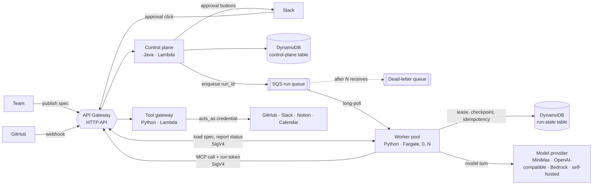
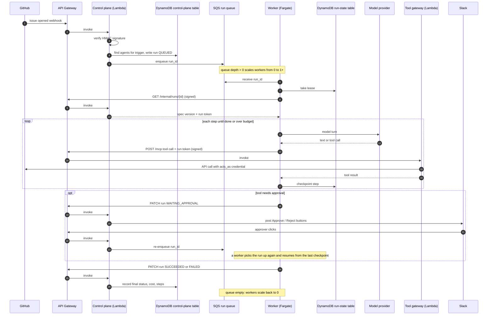

# Architecture

How the platform is built. For what it does and its vocabulary, see [product.md](product.md). For
why a choice was made, see the [decision records](adr/README.md).

## Overview



One OpenTelemetry trace per run, started by the control plane and continued by the worker and the
gateway; the worker uploads its spans to X-Ray ([ADR 0022](adr/0022-run-traces-start-in-the-control-plane.md)).

### Run lifecycle

One run of the issue-triage agent, from webhook to finish:



Nothing is billed per hour while idle: the control plane and gateway are Lambda functions, workers
scale to 0, both data stores are DynamoDB on-demand, and model providers bill per token
([ADR 0007](adr/0007-serverless-scale-to-zero-deployment.md)).

## Components

| Component     | Runs on                 | Owns                                                          | Talks to                                                 |
| ------------- | ----------------------- | ------------------------------------------------------------- | -------------------------------------------------------- |
| Control plane | Lambda (SnapStart)      | Tenants, specs and versions, runs, approvals, Slack bot       | Control-plane DynamoDB table, SQS (send), Slack          |
| Worker        | ECS Fargate, 0..N tasks | Executing one run: agent loop, budget, checkpoints            | SQS (receive), run-state DynamoDB table, model providers, control plane, gateway |
| Tool gateway  | Lambda                  | OAuth tokens, connector definitions, outside API calls        | SSM Parameter Store / KMS, outside APIs                  |

Supporting components are not deployed as services but are built and worked on the same way:

| Component     | Folder                                                    | Purpose                                                              |
| ------------- | --------------------------------------------------------- | -------------------------------------------------------------------- |
| `contracts`   | `contracts/`                                              | Shared schemas: agent spec, run message, run token, internal API, connector allowlist, MCP tool call |
| `specs`       | `specs/`                                                  | Example agent specs (`issue-triage`, `meeting-prep`)                 |
| `evals`       | `evals/`                                                  | Regression tasks, fixtures, LLM judge, CI gate                       |
| `loadtest`    | `loadtest/`                                               | Load driver and chaos script against AWS (stub model, fake connector) |
| `infra`       | `infra/`                                                  | Terraform for every AWS resource                                     |
| `local-stack` | `docker-compose.yml`, `.env.example`, `Makefile`, `local-stack/` | Runs everything locally                                              |
| `ci`          | `.github/workflows/`                                      | Build, test and eval workflows                                       |

The component names in both tables are the names used for work sessions and roadmap tasks.
Managed services (API Gateway, SQS, DynamoDB, SSM Parameter Store, KMS, CloudWatch, X-Ray) and model
providers (MiniMax, Bedrock, others) are not components: code reaches them through adapters inside the services, and `infra` creates them.

Boundaries the design depends on:

- Only the control plane reads or writes the control-plane table
  ([ADR 0001](adr/0001-workers-use-control-plane-api.md), [ADR 0008](adr/0008-control-plane-data-in-dynamodb.md)).
- Only the worker touches the run-state table and calls model providers
  ([ADR 0010](adr/0010-provider-neutral-model-layer.md)).
- Only the gateway holds credentials and calls outside APIs ([ADR 0006](adr/0006-separate-tool-gateway.md)).
- SQS is the only hand-off between control plane and worker.

## Tech stack

| Part             | Choice                                                                |
| ---------------- | --------------------------------------------------------------------- |
| Control plane    | Java 21, Spring Boot 4, Gradle, AWS SDK for Java v2 (plain DynamoDB client), `aws-serverless-java-container-springboot4`, Lambda SnapStart |
| Control-plane DB | DynamoDB on-demand, own table (DynamoDB Local for dev)                |
| API entry        | API Gateway HTTP API, default `execute-api` endpoint (ADR 0021)       |
| Queue            | Amazon SQS with a dead-letter queue (ElasticMQ locally)               |
| Workers          | Python 3.12, uv, own agent loop; model adapters per protocol (OpenAI-compatible, Bedrock Converse) behind a router, ECS Fargate |
| Run state        | DynamoDB (DynamoDB Local for dev)                                     |
| Tool gateway     | Python, FastAPI, MCP Python SDK (stateless Streamable HTTP), Lambda   |
| Secrets          | SSM Parameter Store (SecureString), KMS                               |
| Observability    | OpenTelemetry (Java + Python SDKs), X-Ray with Transaction Search (spans in CloudWatch Logs), CloudWatch |
| Evals / CI       | GitHub Actions, pytest-based eval runner, LLM judge on a configured provider |
| Load test        | Stub model (built-in provider `stub`) + a Python driver (asyncio, httpx, boto3) |
| Infra            | Terraform                                                             |

## Control plane

Public endpoints, all tenant-scoped, authenticated by per-tenant API key:

- `POST /agents`: create an agent. The agent id is its `name`, unique per tenant.
- `POST /agents/{id}/versions`: publish a spec version, YAML or JSON. Validates against
  `contracts/agent-spec.schema.json`, checks `require_approval ⊆ tools` and that the spec `name`
  matches the agent, and (from M4) that tool names exist in the gateway. The new version becomes
  active. Errors return `application/problem+json` with an `errors` list.
- `PUT /agents/{id}/active-version`: set or roll back the active version.
- `POST /runs`: start a run manually (development and testing). Body `{agent, input}`; the run is
  pinned to the agent's active version, saved `QUEUED`, then enqueued. If enqueueing fails the
  response is 503 and the run stays `QUEUED` for the re-enqueue sweep.
- `GET /runs/{id}`: status, steps, cost, trace id, pending approval, approval, failure, output.
- `POST /runs/{id}/approval`: decide the pending call (web approval for development and tests;
  Slack uses the same path). Body `{decision: approved|rejected, step}`; `step` must be the
  pending call's step, so a stale or repeated request cannot decide a later pause (409). The
  decision copies step, tool and arguments from the stored pending call; `decided_by` is
  `api:<tenant>` (an API key names a tenant, not a person). Approved: the run becomes `QUEUED` and
  is enqueued; a failed enqueue still answers 200 and the sweep sends it. Rejected: `FAILED`
  `approval_rejected`. A call is decided once; later requests get 409.

Public and internal JSON use snake_case field names and leave out empty fields.
- `POST /triggers/github`: GitHub webhook, no API key. Verifies `X-Hub-Signature-256` (HMAC-SHA256
  of the raw body with `GITHUB_WEBHOOK_SECRET`, constant-time compare; 401 if wrong, 503 if no
  secret is set). The trigger is `github.<object>.<action>` from `X-GitHub-Event` and the body's
  `action` (`issues` is named `issue`: `github.issue.opened`). Starts one run per agent whose
  active version has that trigger, and answers 202 `{"runs": [...]}` (`ping`: 200, no runs).
  The run input is trimmed for `issues` events to `action`, `repository.full_name`, the issue's
  number, title, body, state, URL, label names and author login, and `sender.login`: the full
  payload is 10-30 KB, mostly URLs, and the model rereads the input on every step. Other events
  pass through whole. Until the GitHub App (M4) maps an installation to a tenant, only agents of
  the configured tenant are matched. Redeliveries: the `X-GitHub-Delivery` id is claimed
  (conditional put, item `DELIVERY#github#<id>`, `ttl` 7 days, covering GitHub's 3-day
  redelivery window) before any run starts; a delivery seen before gets 200 with the first
  delivery's run ids and `"duplicate": true` and starts nothing. If handling fails the claim is
  released, except when only the enqueue failed (runs saved `QUEUED`, the sweep sends them).
- `POST /approvals/slack`: Slack interactivity Request URL, no API key. Verifies
  `X-Slack-Signature` (`v0=` HMAC-SHA256 of `v0:<timestamp>:<raw body>` with
  `SLACK_SIGNING_SECRET`, constant-time compare, timestamp within 5 minutes; 401 if not, 503 if
  no secret). The raw body is read from the request stream: Spring re-encodes form bodies, which
  breaks the signature. Reads the `payload` form field; only Approve / Reject clicks
  (`block_actions`, block `approval`) from `SLACK_APPROVAL_CHANNEL` are applied, through the same
  decision path as `POST /runs/{id}/approval` with `decided_by` = `slack:<user id>`. Anyone who
  can click in that channel may decide (until M4 maps identities). Then `chat.update` replaces the
  clicked message's buttons with the run's outcome (who and when, or "no longer waiting"); a
  failed update keeps the decision. A verified request always gets an empty 200 within Slack's 3
  seconds (400 for a malformed body).

Internal endpoints, for workers and the gateway only. API Gateway requires IAM authorization
(SigV4) on these routes:

- `GET /internal/runs/{id}`: run, spec version, and a signed run token: a new ES256 JWT on every
  GET (claims in `contracts/run-token.schema.json`, `kid` = the public key's RFC 7638 thumbprint,
  valid for the spec's `max_seconds` from issue). It names who published the version (`owner`)
  and what started the run (`started_by`: `api:<tenant>` or `webhook:github`), both recorded by
  the control plane; neither the token nor the keys are logged. The signer is a port
  (`RunTokenSigner`): a key pair from env locally, a KMS key on AWS (`kms:Sign` on the SHA-256
  digest, DER transcoded to JOSE; public key read once with `kms:GetPublicKey`, never at startup;
  [ADR 0018](adr/0018-secrets-in-ssm-signing-in-kms.md)). Without a key configured, no token. Once a pending call is decided, the run carries `approval` (the latest decision); the worker makes the paused call only
  if it is approved and matches step, tool and arguments.
- `PATCH /internal/runs/{id}`: status, steps, cost, trace id, pending approval call, failure
  reason, output. Allowed status changes are listed in `contracts/internal-api.openapi.yaml`.

When a worker reports `WAITING_APPROVAL`, the control plane posts the pending call with Approve /
Reject buttons through the `ApprovalChannel` port
([ADR 0002](adr/0002-control-plane-owns-approvals.md)): Slack `chat.postMessage` to
`SLACK_APPROVAL_CHANNEL` (agent, run, step, the arguments as literal preformatted text cut at 3,000
characters; both buttons carry `{run_id, step}`). Without `SLACK_BOT_TOKEN` requests are only
logged. The post happens inside the worker's PATCH with short timeouts (2 s connect, 3 s answer);
a failed post does not fail the PATCH. Where it was posted (channel, message id) is saved on the
run, only if the run still waits on the same call, so the decision can update the message. The
approval sweep posts runs left unsent for 60 s, up to 20 per sweep, stopping at the first failure.
The PATCH and the sweep can rarely post one call twice; a decision is still recorded once.

Nobody deciding is an outcome too. A run left `WAITING_APPROVAL` longer than
`APPROVAL_TIMEOUT_HOURS` (default 72, from the start of its current pause) is failed by the
approval sweep with `approval_expired` ("Call to <tool> at step <n> got no decision within 72 h"),
conditional on the same pending call, so a click at the same moment and the expiry cannot both
win. The pending call is cleared and `approval` stays unset (an expiry is not a decision). A
posted message shows "Expired" in place of its buttons; a failed update keeps the expiry, and the
rest of that sweep skips Slack; a later click on such a message shows "Expired" too. The setting
must stay under 360 h, the worker's run-state retention
([ADR 0011](adr/0011-run-state-per-step-fenced.md)), or an approved run would find its saved steps
gone; startup fails outside 1 to 359.

Every endpoint must answer in seconds (Slack expects a reply within 3, API Gateway cuts off at
30). Anything slower goes on the queue.

Data lives in one DynamoDB table owned by the control plane
([ADR 0008](adr/0008-control-plane-data-in-dynamodb.md)), designed around these access patterns:

The table has generic keys `PK` / `SK` and two indexes, `GSI1` (`GSI1PK` / `GSI1SK`) and `GSI2`
(`GSI2PK` / `GSI2SK`). Its single definition is
`control-plane/dynamodb/control-plane-table.json`; tests, the local stack and Terraform all create
the table from that file.

| Access pattern                 | Keys                                                                         | Status   |
| ------------------------------ | ---------------------------------------------------------------------------- | -------- |
| Agent, its versions            | `PK=TENANT#<t>#AGENT#<a>`, `SK=META` or `VERSION#<10-digit n>`               | Built    |
| Agents by trigger (webhooks)   | `GSI1PK=TRIGGER#<event>`, `GSI1SK=TENANT#<t>#AGENT#<a>` on the agent item    | Built    |
| Tenant by API key              | `PK=APIKEY#<hash>`                                                           | Planned  |
| Run and its approval           | `PK=RUN#<id>`, `SK=META` (`pendingApproval`, latest `approval` as JSON attributes; `approvalChannel`, `approvalMessageId` once posted) | Built |
| Runs waiting for approval      | `GSI1PK=RUNS#APPROVAL_UNSENT` or `RUNS#APPROVAL_SENT`, `GSI1SK=<waiting-since, 13-digit epoch millis>#<runId>` on the run item (only while `WAITING_APPROVAL`) | Built |
| Runs of an agent, newest first | `GSI2PK=TENANT#<t>#AGENT#<a>`, `GSI2SK=<created time>#<run id>` on the run item | Keys written, no query yet |

- Publishing reads the agent's `latestVersion` n, then in one transaction sets it to n+1 (only if
  it is still n), sets the active version and trigger index, and writes version n+1 (only if it
  does not exist). A lost race retries, so numbers have no gaps or repeats.
- Every run status change is a conditional update on the expected current status. A decision is
  one conditional update on `WAITING_APPROVAL` and the exact pending call text: it sets
  `approval`, removes `pendingApproval` and sets the new status, so two clicks cannot both win.
- A scheduled sweep re-enqueues runs left `QUEUED` too long (status written, enqueue failed):
  while `QUEUED`, a run item carries `GSI1PK = RUNS#QUEUED`, `GSI1SK = <queued-at, 13-digit epoch
  millis>#<runId>` (a sparse index: removed on any other status), so the sweep reads only queued
  runs, oldest first. Each stuck run is touched (queued-at = now, only if still `QUEUED`), then
  published, so it is re-sent at most once per threshold; a second message for a slow run is
  harmless (worker lease and status check). Locally a Spring schedule runs it; on Lambda,
  EventBridge Scheduler invokes it every 5 minutes (M6), since a function is frozen between
  requests. That stays inside the free tiers: $0 while idle, though never completely silent.
- The same schedule runs the approval sweep. A run moving to `WAITING_APPROVAL` enters
  `RUNS#APPROVAL_UNSENT`; recording its post moves it to `RUNS#APPROVAL_SENT` (same sort key); any
  other status, including a rejection or an expiry, removes it. The post sweep reads only the
  unsent partition; the expiry sweep reads both (oldest 20 of each, merged by sort key), then
  expires up to 20.

The same Spring Boot app runs as a normal server locally and behind a Lambda handler in AWS
([ADR 0017](adr/0017-control-plane-on-lambda-snapstart.md)). `lambda/LambdaHandler` passes API
Gateway HTTP API events (payload 2.0) to the Spring MVC app through aws-serverless-java-container,
and runs `Sweeps.runOnce()` for a direct invoke of `{"sweep": "all"}` (EventBridge Scheduler; HTTP
events always carry `routeKey`, so API Gateway cannot trigger it). Spring starts in the handler's
static initializer, before the SnapStart snapshot; a `beforeCheckpoint` hook then sends four
requests that end before any store, queue or Slack call (`lambda/Priming`), so their classes are
in the snapshot. Keep startup light: no eager network calls or connections at startup, and no ids,
secrets or seeds made at startup except with `SecureRandom` (a snapshot is shared by every
restored environment). Measured: a cold Slack click answers in about 2.2 s at 1769 MB (arm64), a
warm one in about 40 ms.

## Worker

The worker core is one function, `handle_run(run_id)`, called from an entrypoint
([ADR 0005](adr/0005-compute-agnostic-worker-core.md)). On Fargate the entrypoint is a poll loop
(`entrypoints/poll_loop.py`):

1. Long-poll SQS for as many messages as there are free run slots. Take the run's **lease** in
   the run-state table (conditional write with expiry, one lease length = the visibility
   timeout) so two workers never run the same run. The owner is new per attempt
   (`<host>-<pid>/<random>`), so one process receiving a run twice runs it once. If another
   worker holds a live lease, keep the message and hide it for one more lease length (deleting it
   could lose the run if the holder then crashes).
2. Load the run and spec from the control plane and the run's checkpoints from the run-state
   table. A run with checkpoints is resumed: its history is rebuilt (the input message comes
   from the run), the steps, cost and working seconds continue from the saved totals, and it
   reports `RUNNING` with the saved step count.
3. Run the agent loop in `core/handle_run.py` ([ADR 0009](adr/0009-worker-owns-agent-loop.md)).
   Every model reply is checked before anything acts on it: tools not in the spec are refused,
   arguments are validated against the tool schema, refused or cut-off replies fail the run.
   After every step (model turn or tool result) save a checkpoint: the messages it added, its
   cost, the working seconds so far, and for a model turn its stop reason. The loop keeps the
   full history and trims only a copy for each call, so saved steps never change. On resume,
   tool calls of the latest turn without a saved result run again, in order; a saved final
   answer is reported without asking the model again. If the store fails, the attempt stops
   without reporting and the run resumes later.
4. Extend the SQS message visibility and renew the lease while working (heartbeat, every third
   of the timeout). If the lease is lost (the worker stalled past its expiry and another took
   over), the run stops before its next step and reports nothing. The lease is released when
   the run ends, so a retry can take it at once. If the worker dies, the message reappears and
   another worker resumes from the last checkpoint.
5. Enforce the budget every step: steps, dollars from token usage, working seconds summed over
   attempts ([ADR 0012](adr/0012-time-budget-counts-working-time.md); time waiting between
   attempts does not count). Over budget means `FAILED` with a reason.
6. A tool in `require_approval`: save the pending call, report `WAITING_APPROVAL`, delete the SQS
   message, exit. The approval re-enqueues the run. On resume the paused call (from the saved
   model turn) runs only if the run's `approval` is `approved` and its step, tool and arguments
   (canonical JSON) equal the call; it then goes through the usual idempotency key, so a later
   resume reuses its result. No or another decision pauses again; the worker never calls a
   rejected call and never sets `approval_*` reasons.

The message is deleted once `handle_run` returns, whatever status the run ended in. It is kept,
so SQS delivers it again and after 5 receives moves it to the DLQ, when the body does not match
`run-message.schema.json`, the run is not found, or the control plane cannot be reached. On
SIGTERM the worker stops polling and finishes the runs it holds.

Each worker task runs several runs concurrently, because most of a run is spent waiting on the
model or an API.

Model providers ([ADR 0010](adr/0010-provider-neutral-model-layer.md)): the spec's `model` is
`<provider>/<model id>`, for example `minimax/MiniMax-M3`. The loop passes it with every call to
the `Model` port; a router adapter looks up the provider in the worker config and forwards to the
adapter for its protocol:

| Protocol | Adapter | Providers |
| --- | --- | --- |
| OpenAI Chat Completions | `model_openai_compat.py` | MiniMax, OpenAI, OpenRouter, Together AI, Gemini (OpenAI-compatible endpoint), vLLM, Ollama, llama.cpp |
| Bedrock Converse | `model_bedrock.py` | Amazon Bedrock (worker's AWS credentials) |

Bedrock adapter rules (boto3 `converse`, no Strands): tool names turn `.` into `_` (Amazon Nova
fails on `-`) and map back through the request's tool list; consecutive tool results merge into one
user message; failed tool results are text starting `Error:`; Nova's `<thinking>` text is dropped
and its `<response>` wrapper removed; `malformed_tool_use` and unknown stop reasons raise
`ModelError`. For Nova, AWS recommends greedy decoding for tool use (temperature 0, extra body
`{"inferenceConfig":{"topK":1}}`). The boto3 client is created on first call, so a worker without
the profile still starts.

Price and context window live in `core/models.py` per `provider/model` (or `provider/*`); a run
whose model is not listed fails before its first step, because every spec has a dollar budget.
Adapters retry throttling, server errors and timeouts with backoff (honoring `Retry-After`)
before raising `ModelError`. Before each call, once the conversation passes 70% of the context
window, `core/trim.py` shortens old tool results, then drops the oldest steps (always keeping the
run input and the latest two steps); if it still does not fit, the run fails. Cost is checked before
each step, so one model turn can overshoot `max_usd` before the run stops. What a provider needs
to see again in later turns (MiniMax's reasoning) travels in `provider_data` on each model turn;
core stores it in the history without reading it.

## Run state

The worker's run-state table ([ADR 0011](adr/0011-run-state-per-step-fenced.md)) has one
partition per run, keys in `worker/dynamodb/run-state-table.json`, TTL in `run-state-ttl.json`:

| SK | Holds |
| --- | --- |
| `LEASE` | `owner`, `expires_at` (epoch seconds), `last_step` |
| `STEP#000001`, ... | `data`: JSON of what that step added; written once |
| `TOOL#<key>` | idempotency claim; `result` once stored |

- Every write except taking the lease checks the writer's live lease in the same transaction
  (fencing); a worker that lost it gets `LeaseLost` and writes nothing. A checkpoint moves
  `last_step` from n-1 to n in that check.
- Payloads are at most 350 KB of JSON. Every item has `ttl` = last write + 15 days; DynamoDB
  deletes expired items, so a run must finish within 15 days of its last step.

## Idempotency

- Every tool call gets a key: SHA-256 of `run_id`, step number, tool name and arguments
  (canonical JSON). A resumed run gives the same call the same step number, because tools run
  only after their model turn is checkpointed.
- Order per call: claim the key (conditional put in the run-state table), call the tool, store
  the result (tool errors too), then checkpoint the step. A key with a stored result returns
  that result instead of calling the API again.
- A key claimed without a result (the worker died during or right after the call) means the
  outcome is unknown. The call is repeated only if the tool is `read_only` or `idempotent` (MCP
  annotations); otherwise the run fails, saying so
  ([ADR 0013](adr/0013-unknown-tool-outcome.md)).
- This is what makes "worker killed mid-run, zero duplicate Slack posts or issue closes" true.

## Tool gateway

- Input: an OpenAPI 3 spec plus an allowlist of `operationId`s per connector. Output: one MCP tool
  per allowed operation, with a JSON Schema built from its parameters and request body.
- Connectors: GitHub (M4), later Slack, Notion, Google Calendar. Adding one means adding a folder
  with `openapi.yaml` and `allowlist.yaml`; code only for a named hook
  ([ADR 0014](adr/0014-connector-rules-and-hooks.md)).
- Operations not on the allowlist do not exist as tools.
- The allowlist also limits each tool: argument rules (allowed values such as repos, enums, text
  added to a query, words refused), the result fields kept (GitHub: no issue bodies), MCP
  annotations (`readOnlyHint`, `idempotentHint`, read by the worker as `read_only` /
  `idempotent`), and an optional `hook`: a function in `connectors/<name>/hooks.py` for checks that
  need extra calls (GitHub: existing labels only, close reads the issue first, `duplicate_of` to
  issue id). Rules run first; a hook cannot widen them.
- A hook may also add text to its tool's description at `tools/list`, using the run's credential
  (GitHub: the existing labels of each allowed repo). If that fails, the plain description is
  listed; listing never fails because of it.
- Generation, at startup: the allowlist must follow the contract; tool names carry the connector
  prefix; operations, listed and fixed arguments, check templates, hooks and hook operations must
  exist; enum rules may only narrow the API's. Each tool's input schema is the operation's schema
  for the listed arguments (refs inlined, OpenAPI-only keywords dropped) plus `maxLength` /
  `maxItems` / `enum` from the rules. Settings an allowlist names (`GITHUB_REPOS`) are read then;
  a missing one fails startup. `openapi.yaml` is cut from the vendor's official description by
  `scripts/cut_openapi.py` (GitHub: 5 operations, about 120 KB of 14 MB) and committed.
- `CONNECTOR_<NAME>_BASE_URL` replaces a connector's `base_url` at startup, for evals and tests
  that point a real connector at a simulator. Only addresses on the same machine are accepted
  (`127.0.0.1`, `localhost`, `::1`), because the override receives the connector's credentials
  (GitHub: the App token exchange); startup logs every override.
- A call: checks, then argument rules (refuse, append, scope qualifiers), then the hook or the
  request (path, query or JSON body as the operation says, connector `headers`, the credential),
  then the result shape (`fields`; with `list`, `{"items": [...]}`). 5xx and network errors are
  retried 3 times; rate limits are reported, not retried; 4xx answers reach the model as
  "<connector> answered <status>: <message>". Calls run in a worker thread.
- Identity: `acts_as: team-bot` uses the tenant's bot: a GitHub App (app id, private key,
  installation id in the `TokenStore`); the gateway signs a 10-minute app JWT, exchanges it for the
  installation token, caches that until 5 minutes before its hour ends, and renews once if GitHub
  answers 401. The App's installation (only the allowed repos, Issues and Metadata) is a second
  limit beside `GITHUB_REPOS`. `acts_as: owner` uses the owner's own token from a one-time login
  through the same App ([ADR 0015](adr/0015-owner-login-through-the-github-app.md)): an owner run
  without one fails with a tool error naming `<GATEWAY_PUBLIC_URL>/oauth/github/start?ticket=...`
  (a ticket signed with `OAUTH_STATE_SECRET`, 10 minutes). `/start` sets a nonce cookie and sends
  GitHub a signed `state` and a PKCE S256 challenge (verifier derived from the nonce, never
  stored); `/callback` checks state and cookie, exchanges the code, reads the login from
  `GET /user`, and stores tokens, expiry times and login under `(tenant, owner, github)`. Calls
  refresh the token within 5 minutes of expiry or after a 401 (GitHub replaces the refresh
  token); a refused refresh deletes the login. Without the `GITHUB_OAUTH_*` settings `/oauth/*`
  answers 503 and owner runs are refused. uvicorn's request log hides `/oauth/` query strings.
- Every call writes an access log line: run, tenant, agent and version, `started_by`, the identity
  acted as, tool, argument hash, outcome, and the run's `trace_id` (to find its trace in X-Ray).
  Never a token or argument values.
- Built in stages: in M1 tool calls ran inside the worker; since M4 they run in this service
  ([ADR 0006](adr/0006-separate-tool-gateway.md)), and the Docker worker always uses it. The M1
  adapter (`worker/.../tools_local.py`, kept for host runs and tests) enforces the same rules: a repo allowlist, search kept inside the repo, short
  results without issue bodies, labels limited to existing ones, and closing only real issues
  (read first: pull requests refused, an already closed issue left as it is).
- Runs on Lambda behind the shared API Gateway. `/mcp` requires IAM authorization (SigV4) and a
  valid run token. MCP uses stateless Streamable HTTP with JSON responses, so nothing depends on a
  warm instance. The `/oauth/` routes are public (a browser calls them) and keep no state. The
  unchanged uvicorn app runs under the Lambda Web Adapter layer
  ([ADR 0019](adr/0019-gateway-on-lambda-web-adapter.md)): a zip (`scripts/lambda_zip.py`,
  python3.12, arm64), handler `run.sh`, readiness `/health`. The zip carries precompiled bytecode
  (Lambda's code folder is read-only, so otherwise every cold start compiles all the Python): a
  cold start takes about 2.0 s (3.4 s before, 3.7 s with OpenTelemetry and no bytecode).
- On AWS (ADR 0018), startup reads the run-token public key from KMS (`RUN_TOKEN_KMS_KEY_ID`) and
  the OAuth secrets from SSM (`SECRETS_SSM_PATH`); the `TokenStore` is SSM SecureString, one
  parameter per credential at `<TOKEN_STORE_SSM_PATH>/<tenant>/<identity>/<provider>` (characters
  outside `A-Z a-z 0-9 . -` escaped as `_XX`; at most 4 KB; read on every call, never cached, since
  GitHub replaces refresh tokens). An operator puts the GitHub App credential with
  `scripts/put_app_credential.py`.
- The run token travels in the `X-Run-Token` header, because on AWS `Authorization` carries the
  caller's SigV4 signature, which API Gateway checks on `/mcp` first (contract
  `mcp-tool-call.schema.json`, [ADR 0020](adr/0020-run-token-in-its-own-header.md)). When
  `X-Run-Token` is present it decides alone; without it the gateway still accepts
  `Authorization: Bearer`, which unsigned workers also send, until both copies are dropped.
- Every `/mcp` request (`initialize` and `tools/list` too) needs a valid run token: ES256, `kid`
  equal to the configured public key's thumbprint, issuer, audience, expiry and issue time within
  30 s, claims valid against the contract. Otherwise HTTP 401 with a JSON-RPC error and no detail.
  `tools/list` shows the tools in both the token and the loaded connectors; `tools/call` refuses
  others and calls without the `agentplatform/` `_meta` keys (JSON-RPC errors), checks arguments
  against the tool's schema (a tool error the model can read), and returns the tool's JSON in
  `structuredContent` and as text. `GET /health` needs no token.
- Second approval check, for a tool in the token's `require_approval`, after the argument check:
  the gateway reads `GET /internal/runs/{sub}` (`CONTROL_PLANE_URL`) and runs the call only if the
  run is the token's run and tenant, `RUNNING`, and its `approval` is `approved` for the same step,
  tool and canonical JSON arguments (the worker's comparison). Anything else, including a control
  plane that cannot answer or no `CONTROL_PLANE_URL`, refuses with one generic tool error; the
  access log has the reason. Calls to the control plane are signed with SigV4 on AWS (M6), like
  the worker's.

## Security

- **Credentials live only in the gateway.** OAuth refresh tokens and bot tokens are SSM
  SecureString parameters (encrypted with KMS) under the gateway's path; only the gateway's IAM
  role can read them (ADR 0018). Workers and the model never see a token.
- **Run identity.** Each agent declares `acts_as`. Issue triage uses a team bot (GitHub App, Slack
  bot), because a webhook-triggered run has no calling user.
- **Signed run token.** The control plane issues a short-lived JWT per run with `run_id`,
  `tenant`, `agent_version`, `acts_as` and the allowed tools, expiring after `max_seconds`. The
  gateway verifies it, picks the credential from `acts_as`, and refuses any tool not listed
  ([ADR 0003](adr/0003-run-identity-and-run-token.md)).
- **Approval checked twice.** The worker pauses before a `require_approval` tool, and the gateway
  confirms with the control plane that an approval exists before running it.
- **Webhooks verified.** GitHub HMAC and Slack signing secret on every inbound call.
- **No secrets in telemetry.** Tokens never appear in spans or logs.
- **Not covered:** misuse of a tool the agent is allowed to call. Small allowlists, approvals and
  budgets limit the damage.

## Ports and adapters

Swappable backends sit behind interfaces designed around what the platform needs, not the vendor
API ([ADR 0004](adr/0004-ports-and-adapters.md)). Config picks the adapter.

| Port                | Lives in      | Behavior every adapter must provide                                                                 | Adapters                                   |
| ------------------- | ------------- | --------------------------------------------------------------------------------------------------- | ------------------------------------------ |
| `RunQueuePublisher` | control plane | Enqueue a run id                                                                                    | SQS, in-memory                             |
| `AgentStore`        | control plane | Tenants, agents, immutable versions with gap-free numbering, lookup by trigger                     | DynamoDB, in-memory                        |
| `RunStore`          | control plane | Runs, steps, approvals; status changes only from the expected current status                       | DynamoDB, in-memory                        |
| `DeliveryStore`     | control plane | Claim a webhook delivery id once (first caller wins), record its runs, release; forgotten after 7 days | DynamoDB, in-memory                        |
| `RunQueue`          | worker        | At-least-once delivery, redelivery after timeout, extendable timeout, delivery count, DLQ after N   | SQS, in-memory                             |
| `RunStateStore`     | worker        | Atomic conditional writes for lease, checkpoint (step n only after n-1), idempotency claim         | DynamoDB, in-memory                        |
| `Model`             | worker        | Model id + messages + tools in; text or tool calls, stop reason, token usage out; retries transient errors | Stub (scripted), router, OpenAI-compatible (M1), Bedrock Converse (M1) |
| `ToolClient`        | worker        | `describe(names, context)` returns tool schemas; `call(name, args, context)` returns a result or raises `ToolError`; `context` is the run id, run token, step and idempotency key | Fake (tests), direct calls (M1), MCP gateway (M4) |
| `Tracer`            | worker        | `span(name, attributes, parent=traceparent)` as a context manager, `annotate` the current span, `traceparent()` of the current span; failures mark the span with the exception type only | No-op (core default), OpenTelemetry |
| `Metrics`           | worker        | `model_cost(usd)` per model call; never raises (a lost value must not fail the run); safe from many threads | No-op (core default), CloudWatch EMF on stdout |
| `ControlPlane`      | worker        | Internal run API: get a run, report a status change; 409 becomes `RunConflict`                      | In-memory (tests), HTTP + SigV4             |
| `RunTokenSigner`    | control plane | `keyId()` (RFC 7638 thumbprint), `publicKey()`, `sign(input)` returns an ES256 signature in JOSE form; no network call at construction | Local key pair, KMS |
| `SecretSource`      | control plane | `get(secret)` (null = not set; may load on first use, never at startup), `peek` (only what is held), `configured`, `prefetch` | Env, SSM Parameter Store |
| `ApprovalChannel`   | control plane | Post an approval request, return where it went; show its outcome on that message; failures raise `ApprovalChannelException` | Slack, in-memory (logs only)               |
| `TokenStore`        | gateway       | Store and load encrypted tokens per identity and provider                                            | SSM Parameter Store SecureString (M6), in-memory |

- Each port has one contract test suite that runs against every adapter.
- ElasticMQ and DynamoDB Local are not adapters; they test the AWS adapters locally.

## Configuration

No shared runtime config folder. Terraform creates resources and outputs their names. Each service
declares config only for what it touches (`application.yml` in Java, `config.py` in Python) and
reads values from environment variables: `.env` locally; in AWS, the Lambda function or ECS task
definition environment, with secrets from SSM Parameter Store (SecureString,
[ADR 0018](adr/0018-secrets-in-ssm-signing-in-kms.md)) at `/agent-platform/dev/<service>/<name>`:
`control-plane/` `tenant-api-key`, `github-webhook-secret`, `slack-bot-token`,
`slack-signing-secret`; `worker/model/<provider>/api-key`; `gateway/` `github-oauth-client-secret`,
`oauth-state-secret`. The run-token private key is a KMS key on AWS (`alias/agent-platform-dev-run-token`).

| Resource            | Used by                                | Env vars                                                |
| ------------------- | -------------------------------------- | ------------------------------------------------------- |
| Control-plane table | control plane                          | `STORE_BACKEND=dynamodb\|memory`, `CONTROL_PLANE_TABLE` |
| SQS run queue       | control plane (send), worker (receive) | `QUEUE_BACKEND=sqs\|memory`, `RUN_QUEUE_URL`            |
| Run-state table     | worker                                 | `STATE_BACKEND=dynamodb\|memory`, `STATE_TABLE`         |
| Control plane URL   | worker, gateway                        | `CONTROL_PLANE_URL` (the API's URL on AWS; SigV4-signed) |
| Gateway URL         | worker (from M4)                       | `TOOL_GATEWAY_URL` (the API's URL on AWS); `TOOL_GATEWAY_SIGV4=true` signs requests (AWS; default false) |
| Model providers     | worker                                 | `MODEL_PROVIDERS` (names); per name `MODEL_<NAME>_PROTOCOL=openai\|bedrock`; optional `MODEL_<NAME>_MAX_TOKENS`, `MODEL_<NAME>_TEMPERATURE`, `MODEL_<NAME>_EXTRA_BODY` (JSON added to each request, for example `{"reasoning_split":true}` for MiniMax); `openai`: `MODEL_<NAME>_BASE_URL`, `MODEL_<NAME>_API_KEY` (secret); `bedrock`: optional `MODEL_<NAME>_REGION` (else `AWS_REGION`), `MODEL_<NAME>_AWS_PROFILE` (named profile; ignores the env-var keys). Built-in `stub`: optional `MODEL_STUB_LATENCY_MS` (0 to 60000, default 0), a fixed wait before each reply (load tests) |
| Tools               | worker                                 | `TOOLS_PROVIDER=fake\|local\|mcp`; for `local` (M1): `GITHUB_TOKEN` (secret), `GITHUB_REPOS` (allowlist), optional `GITHUB_API_URL`; for `mcp` (M4): `TOOL_GATEWAY_URL`, no GitHub token |
| Worker runtime      | worker                                 | `WORKER_CONCURRENCY` (runs per task), `RUN_VISIBILITY_SECONDS` |
| Metrics             | worker                                 | `METRICS_NAMESPACE` (CloudWatch namespace of the `ModelCostUsd` EMF line; unset = none; `AgentPlatform/dev` on AWS; ADR 0023) |
| Token store         | gateway                                | `TOKEN_STORE=ssm\|memory`; ssm: `TOKEN_STORE_SSM_PATH` (`/agent-platform/dev/gateway/tokens`) |
| Tracing             | control plane, worker, gateway         | `TRACING_EXPORTER` (default none: spans and trace context are made, nothing is uploaded; ADR 0022). Control plane and gateway: `none\|logging` (none on Lambda). Worker: `none\|logging\|xray`; `xray` uploads to the X-Ray OTLP endpoint with SigV4 in `AWS_REGION` (Fargate) |
| Gateway on AWS      | gateway                                | `RUN_TOKEN_KMS_KEY_ID` (instead of `RUN_TOKEN_PUBLIC_KEY`), `SECRETS_SSM_PATH` (`/agent-platform/dev/gateway`: `GITHUB_OAUTH_CLIENT_SECRET`, `OAUTH_STATE_SECRET`), `CONTROL_PLANE_SIGV4=true` with `AWS_REGION`; Lambda: `AWS_LAMBDA_EXEC_WRAPPER=/opt/bootstrap`, `AWS_LWA_READINESS_CHECK_PATH=/health` |
| GitHub App (local)  | gateway                                | With `TOKEN_STORE=memory`, all or none: `TENANT_ID`, `GITHUB_APP_ID`, `GITHUB_APP_INSTALLATION_ID`, `GITHUB_APP_PRIVATE_KEY_FILE` (path to the `.pem`, kept outside the repo); stored as the tenant's team-bot at startup. On AWS the `TokenStore` is written by an operator |
| Owner login         | gateway                                | All three or none: `GITHUB_OAUTH_CLIENT_ID`, `GITHUB_OAUTH_CLIENT_SECRET` (secret), `OAUTH_STATE_SECRET` (secret, 32+ characters); `GATEWAY_PUBLIC_URL` (default `http://localhost:8090`, where browsers reach the gateway). Unset: owner runs refused (ADR 0015) |
| Gateway             | gateway                                | `CONNECTORS` (comma list: `fake`, `github` from M4), `GATEWAY_HOST` (default 127.0.0.1), `GATEWAY_PORT` (default 8090), `CONTRACTS_DIR` (default `../contracts`) |
| Run token key       | control plane signs, gateway verifies  | `RUN_TOKEN_PRIVATE_KEY` (secret, control plane), `RUN_TOKEN_PUBLIC_KEY` (control plane checks the pair and derives `kid`; gateway verifies); P-256 PEM or one-line base64 body; both unset = no tokens. On AWS instead: `RUN_TOKEN_KMS_KEY_ID` (key id, ARN or alias; not together with the pair) |
| Control-plane secrets | control plane                        | `SECRETS_SOURCE=env\|ssm` (default env: `TENANT_API_KEY`, `GITHUB_WEBHOOK_SECRET`, `SLACK_BOT_TOKEN`, `SLACK_SIGNING_SECRET`); ssm: `SECRETS_SSM_PATH` (`/agent-platform/dev/control-plane`), read on first use and kept per environment; with ssm, `SLACK_APPROVAL_CHANNEL` is required |
| Slack bot           | control plane                          | `SLACK_BOT_TOKEN` (secret; unset = approvals only logged), `SLACK_APPROVAL_CHANNEL` (channel id), `SLACK_SIGNING_SECRET` (secret), optional `SLACK_API_URL` (tests) |
| GitHub webhooks     | control plane                          | `GITHUB_WEBHOOK_SECRET` (secret; unset turns `/triggers/github` off) |
| Re-enqueue sweep    | control plane                          | `SWEEP_INTERVAL_SECONDS` (default 60, 0 = off; 0 on Lambda), `SWEEP_QUEUED_AFTER_SECONDS` (default 300) |
| Approval expiry     | control plane                          | `APPROVAL_TIMEOUT_HOURS` (default 72; 1 to 359, under the worker's 15-day run-state retention) |
| Local AWS endpoints | all                                    | `AWS_ENDPOINT_URL_DYNAMODB`, `AWS_ENDPOINT_URL_SQS` (unset in AWS; read by both AWS SDKs) |
| Tenant (M0 only)    | control plane                          | `TENANT_ID`, `TENANT_API_KEY`                           |

The "Used by" column is also each service's least-privilege IAM role (Lambda execution role or ECS
task role). The model comes from
the spec as `<provider>/<model id>`; config only defines the providers
([ADR 0010](adr/0010-provider-neutral-model-layer.md)).

## Observability

One trace per run ([ADR 0022](adr/0022-run-traces-start-in-the-control-plane.md)):

- **The control plane starts it** when it creates the run: a "run.start" span with no parent (the
  request or webhook that caused it is a link, so each run has its own trace). The run stores its
  W3C `traceparent` (`trace_id` in the API is its trace id) and every run message carries it in
  the SQS message attribute `traceparent` (not in the body). An approval decision ("run.approval")
  and a sweep re-send ("run.requeue") add a child of "run.start" and send their own `traceparent`.
- **The worker continues it** on every attempt and sends `traceparent` on internal API and `/mcp`
  calls; the gateway continues it on every `/mcp` request and sends it on its approval check's
  `GET /internal/runs/{id}`, never to a connector's API. Only `/internal/*` and `/mcp` (both
  IAM-authorized on AWS) may join a caller's trace.
- **Spans:** in the control plane one SERVER span per request (`<METHOD> <route>`, status, run id
  from the route) and one per AWS SDK call (DynamoDB, SQS, KMS, SSM); in the worker one per model
  call ("model.call"), tool call ("tool.call") and checkpoint write ("checkpoint"), all under one
  "run.attempt" span per queue delivery whose parent is the message's `traceparent`; in the
  gateway "mcp.tools_list" and "tool.execute" (children of the worker's span, with the outcome),
  "approval.check", and "connector.request" per HTTP attempt (connector, operationId, status,
  attempt; no URL, since paths and queries hold argument values). Attributes:
  tenant, agent, spec version, run, step, model, input/output tokens, cost, tool name. Never input,
  output, issue text, tokens, keys, headers or exception messages.
- **Upload:** the worker sends its spans to the X-Ray OTLP endpoint (SigV4); this needs
  Transaction Search on in the account, which stores spans in the `aws/spans` log group. The
  control plane on Lambda uploads nothing (`TRACING_EXPORTER=none`, active tracing off): measured,
  Lambda's X-Ray agent forwarded spans only for sampled requests and none after a SnapStart
  restore, and active tracing added about 250 ms to a cold start. Its latency is read from the
  Lambda REPORT log lines. The gateway on Lambda uploads nothing either (`TRACING_EXPORTER=none`;
  an upload would be one more HTTPS call before every response, since Lambda freezes the process
  after it): the worker's "tool.call" span times each call, and the access log's `trace_id` links
  the gateway's lines to the trace.

Metrics ([ADR 0023](adr/0023-route-throttling-and-model-spend-alarm.md)): the worker writes the
cost of every model call (US dollars, from `core/models.py` prices) as a CloudWatch embedded
metric format line on stdout: namespace `METRICS_NAMESPACE`, metric `ModelCostUsd`, no
dimensions (nothing written when unset). The `awslogs` driver ships it and CloudWatch extracts the
metric; the model spend alarm (Deployment) sums it. A free model (the stub) writes 0, so every
model call shows as a sample. The line goes to stdout and logs to stderr; a failed write is
logged and never fails the run.

## Testing

- **Unit and contract tests** in each service. Contract tests run every port's suite against every
  adapter.
- **Smoke test:** `make up && make demo` runs the whole platform in Docker (control plane, tool
  gateway with the fake connector, worker) and one run of the example spec to `SUCCEEDED` with
  the stub model, its tool calls through the gateway with a locally generated run-token key pair.
- **Evals** (`evals/`, [ADR 0016](adr/0016-agent-evals-run-worker-code-in-process.md)): measure an
  agent's decisions, not the platform. One harness serves every
  spec: an agent's tasks (`tasks/<spec name>/`) give the trigger event, the starting state of the
  outside world, and checks (tools called or not, end state, output, budget, an LLM judge on free
  text against the author's rubric; it counts only once it agrees with labeled answers, at
  least 90%). `make eval` runs on the
  host in one process: the worker's `handle_run` with in-memory adapters and the spec's real
  model, tools through the real gateway pointed at simulated services (one per connector,
  scripted responses otherwise). Each task runs 3 times; a regression is a task that passed in
  the committed baseline failing, or the pass rate dropping more than 5 points. A CI gate on pull
  requests comes later.
- **Load and chaos** (`loadtest/`, M7, on AWS): the stub model returns scripted tool calls with
  fixed latency, tools through the gateway's fake connector. A Python driver starts 100, then
  1,000 runs and measures queue-to-start p50/p95 (the run's `created_at` against its first
  "run.attempt" span in `aws/spans`), runs per minute, worker CPU and memory. Stopping random
  worker tasks mid-run counts lost runs and duplicate side effects (same run, step and arguments
  hash in the gateway access log); target 0 for both.

## Deployment

Goal: no hourly cost while idle ([ADR 0007](adr/0007-serverless-scale-to-zero-deployment.md)).

```
AWS (one region)                                idle cost
├── API Gateway HTTP API                        $0    per request
│   └── default endpoint <api-id>.execute-api.<region>.amazonaws.com
├── Lambda (not in a VPC)
│   ├── control-plane   Java 21 + SnapStart     $0    per request
│   └── tool-gateway    Python + Web Adapter    $0    per request
├── ECS Fargate (public subnet, no NAT)
│   └── worker service, 0..N tasks              $0 at 0 tasks, per second while running
├── DynamoDB on-demand
│   ├── control-plane table                     ~$0   storage only
│   └── run-state table (from M2)               ~$0   storage only
├── SQS run queue + dead-letter queue           $0    per request
├── Bedrock (if configured)                     $0    per token
├── SSM Parameter Store (secrets, tokens)       $0    standard tier
├── EventBridge Scheduler (sweeps, 5 min)       $0    free tier
├── KMS key                                     $1 per month
└── ECR, CloudWatch logs and alarms, X-Ray      cents
```

- **API entry:** one API Gateway HTTP API on its default `execute-api` endpoint, no custom domain
  ([ADR 0021](adr/0021-default-api-endpoint-no-custom-domain.md)); the address stays the same
  across deploys and is read from `terraform output api_url`. Stage `$default`, auto-deployed,
  payload format 2.0. Routes:

  | Route | Function | Authorization |
  | --- | --- | --- |
  | `ANY /agents`, `/agents/{proxy+}`, `/runs`, `/runs/{proxy+}` | control plane | none at the API; `X-Api-Key` in the app |
  | `POST /triggers/github`, `POST /approvals/slack` | control plane | none at the API; webhook and Slack signatures in the app |
  | `ANY /internal/{proxy+}` | control plane | IAM (SigV4): worker and gateway roles |
  | `ANY /mcp` | tool gateway | IAM (SigV4): worker role; the gateway also checks the run token |
  | `GET /oauth/{proxy+}` | tool gateway | none at the API; signed state in the app |

  Access logs (14 days) record route, status, latency and caller, never headers, query strings
  or bodies. Route throttling ([ADR 0023](adr/0023-route-throttling-and-model-spend-alarm.md)):
  the stage gives every route its own limit, 5 requests per second with bursts of 10
  (`api_throttle_rate`, `api_throttle_burst`), answered 429 before any Lambda runs. It is
  best-effort (measured: about 23 per second admitted at 25 sent), and requests refused by IAM
  are not counted; the hard ceiling is the account's 10 concurrent Lambda executions (503 above
  it).
- **Control plane:** Lambda, Java 21 with SnapStart, 1769 MB, arm64, invoked through the alias
  `live` of a published version (SnapStart only applies to those; each publish waits about 85 s
  for the snapshot). Code: the `lambdaZip` zip, uploaded through an S3 artifacts bucket (it is
  close to Lambda's 50 MB direct-upload limit), handler `LambdaHandler::handleRequest`.
  EventBridge Scheduler invokes the alias with `{"sweep": "all"}` every 5 minutes. Not in a VPC.
- **Tool gateway:** Lambda, Python 3.12, 512 MB, arm64, with the Lambda Web Adapter layer (ADR
  0019), behind the same HTTP API; zip through the same bucket. Not in a VPC. Connectors from
  `gateway_connectors` (`fake` for stub checks, `github` live, with `github_repos`); the GitHub
  App credential is in the SSM `TokenStore`, written once with `put_app_credential.py`. Live, the
  GitHub App's webhook and the Slack app's Request URL point at the API.
- **Workers:** one ECS Fargate service (0.5 vCPU, 1 GB, linux/arm64 image from
  `worker/Dockerfile`, `make worker-image`; ECR tag = git commit), 0 tasks when idle. Model API
  keys reach the container through the task definition's `secrets` from SSM
  (`/agent-platform/dev/worker/model/<provider>/api-key` as `MODEL_<NAME>_API_KEY`). Public
  subnets with a public IP, no NAT gateway; the security group allows only outbound 443. Step
  scaling on two CloudWatch alarms: messages waiting in the run queue for one minute add tasks
  sized to the backlog (1-9 waiting: +1, 10-49: +5, 50 or more: +10; up to `worker_max_tasks`, 2
  in dev; 2-minute cooldown; [ADR 0024](adr/0024-load-test-mode-and-backlog-sized-scale-out.md)),
  and five minutes with nothing waiting or in flight sets the service to 0. Measured on dev (2026-11-19): a stub run after idle finished
  207 s after it was started, nearly all of it a worker starting; the service was back at 0 tasks
  458 s after the run. A Lambda entrypoint, or starting the service on enqueue, can be added if
  scale-out is too slow. The task definition sets `TRACING_EXPORTER=xray`: workers send spans
  straight to the X-Ray OTLP endpoint (task role: `xray:PutTraceSegments`, `xray:PutSpans`), and
  `METRICS_NAMESPACE=AgentPlatform/dev` for the model spend metric (Observability).
- **Traces:** X-Ray with Transaction Search, an account setting turned on once by hand (CloudWatch
  console → X-Ray → Transaction Search). It made the `aws/spans` log group, which Terraform took
  over (import) for its retention (14 days) and keeps on `destroy` (`skip_destroy`). Only the
  workers upload; the Lambdas send nothing and have active tracing off (ADR 0022).
- **Alerts** (ADR 0023): SNS topic `agent-platform-dev-alerts` emails `alert_email`
  (git-ignored tfvars; the subscription is confirmed once). The alarm
  `agent-platform-dev-model-spend` fires when `AgentPlatform/dev` `ModelCostUsd` sums above
  `model_spend_alarm_usd` (1 USD) over the last 24 hours (a one-day period ends at each
  evaluation, not at midnight), and emails again on OK. It is an email, not a stop: per-run
  budgets cap each run; stopping everything is setting the worker service to 0. AWS's own bill
  has the budgets in `bootstrap/`.
- **Load-test mode** (ADR 0024): `load_test = true` in `terraform.tfvars` switches, for one
  test, to `load_test_settings`: throttle 200 per second (burst 400), up to 20 workers, the
  gateway on the fake connector, the stub model at 2,000 ms a call (`MODEL_STUB_LATENCY_MS`);
  `false` restores the normal values with one apply. `aws_demo.py` runs its own agent
  `demo-stub` (trigger `manual.demo.run`) and needs the fake connector.
- **Logs:** every log group keeps 14 days (`log_retention_days`), including the two Transaction
  Search made (`aws/spans`, `/aws/application-signals/data`), imported with `skip_destroy`.
- **Network:** one VPC with two public subnets (two availability zones) and an internet gateway;
  the default security group has no rules. Only the workers run in it.
- **IAM:** one role per service, each allowed only what it calls (tables, queue, its own SSM path,
  the KMS key, `execute-api:Invoke` on `/internal/*` and `/mcp`); the scheduler may invoke only
  the control plane's alias.
- **Data:** two DynamoDB tables (control plane, run state), on-demand capacity, built from the
  services' JSON definitions (`control-plane/dynamodb/`, `worker/dynamodb/`), names
  `agent-platform-dev-<table>`. The control-plane table has deletion protection and
  point-in-time restore (specs and versions); the run-state table neither (15-day TTL). SQS
  `agent-platform-dev-runs` (dead-letter queue after 5 receives, kept 14 days), SSE-SQS. ECR
  `agent-platform-dev-worker` (immutable tags, last 10 images).
- **Secrets and keys** ([ADR 0018](adr/0018-secrets-in-ssm-signing-in-kms.md)): SSM SecureString
  parameters with the `aws/ssm` key, readable per service path through IAM; Terraform makes them
  with a write-only random placeholder and never holds a value; the user puts values with
  `infra/scripts/put_secrets.py`. Run tokens are signed by a KMS `ECC_NIST_P256` key.
- **Terraform:** applied from the laptop with the AWS profile `default`. `infra/bootstrap/` (made
  once, local state) holds the state bucket and the budgets ($10 a month on the `project` tag, $90
  for the account), so destroying an environment leaves the alerts on; `infra/envs/dev/` keeps its
  state in that bucket with Terraform's lock file. Every resource is tagged `project =
  agent-platform`. Personal values (Slack channel, GitHub OAuth client id, worker image tag) are
  in git-ignored `terraform.tfvars`.
- **Not used:** load balancer, NAT gateway, interface VPC endpoints, RDS, RDS Proxy, always-on EC2.
- **Model providers:** billed per token, nothing when idle. Non-AWS providers (MiniMax, OpenAI,
  OpenRouter) are reached over the internet from the public subnet; their API keys are in SSM
  Parameter Store. Bedrock, if configured: on-demand, no Provisioned Throughput; enable model access in the
  deploy region first.

## Repository layout

Planned layout. Once a service has code, its own `README.md` and the code itself replace the
detail here; trim this section to folder level at that point.

```
contracts/
  agent-spec.schema.json        run-message.schema.json
  run-token.schema.json         internal-api.openapi.yaml
  connector-allowlist.schema.json  mcp-tool-call.schema.json

control-plane/                  Java 21, Spring Boot 4, Gradle (see control-plane/AGENTS.md)
  dynamodb/                     control-plane table definition
  src/main/java/dev/agentplatform/controlplane/
                                one package per area: agent, run, trigger, internal, store,
                                queue, contract, tenant, config, web, approval, token, secret, lambda,
                                trace

worker/                         Python 3.12, uv, own agent loop (see worker/AGENTS.md)
  src/worker/                   core/ (no vendor imports), ports/, adapters/, entrypoints/,
                                config.py, wiring.py
  tests/                        contract/, unit/, integration/

tool-gateway/                   Python, MCP SDK (Starlette) + uvicorn (see tool-gateway/AGENTS.md)
  src/gateway/
    config.py  contracts.py  app.py  __main__.py  (lambda_handler.py in M6)
    auth/       run_token
    tools/      registry, access_log, openapi_to_mcp (generator), rules, executor
    credentials.py
    oauth/      signing (tickets, state), github (provider), logins (flow, refresh), routes
    ports/      token_store
    adapters/   token_store_memory (token_store_ssm in M6)
    connectors/ fake (in code, a test double)
  connectors/   github/, later slack/ notion/ gcal/   (openapi.yaml + allowlist.yaml [+ hooks.py])
  scripts/      cut_openapi.py (cuts a connector's openapi.yaml from the vendor's description)
  tests/

specs/          issue-triage.yaml, meeting-prep.yaml
evals/          tasks/<spec>/, simulators/, runner/ (run_suite, checks, judge, compare), labels/, baselines/
loadtest/       driver and chaos scripts (Python), report.md
infra/          bootstrap/ (state bucket, budgets; local state), envs/dev/ (see infra/AGENTS.md)
```

Root files: `docker-compose.yml` (DynamoDB Local, ElasticMQ, and every service built from its own
`Dockerfile`), `.dockerignore`, `.env.example`, `Makefile` (`up`, `stack`, `demo`, `down`),
`.github/workflows/` (one workflow per service plus evals). Each service folder owns its
`Dockerfile`; images build with the repo root as context because services bundle `contracts/`.
